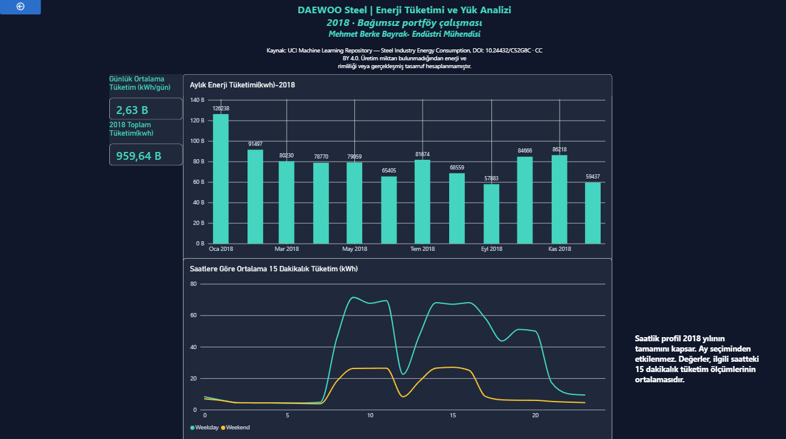
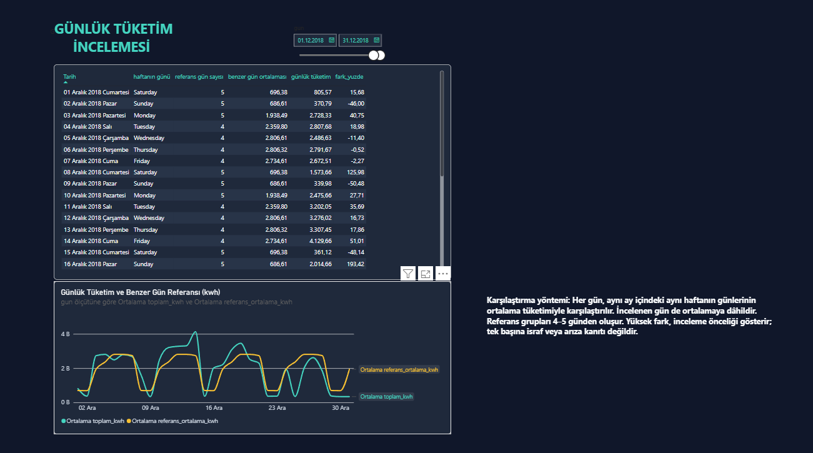

# DAEWOO Steel — Enerji Tüketimi ve Yük Analizi

**Hazırlayan:** Mehmet Berke Bayrak | Endüstri Mühendisi  
**Araçlar:** PostgreSQL 18, SQL, Power BI

2018 yılına ait 15 dakikalık enerji tüketimi verilerini
inceleyen bağımsız portföy çalışmasıdır.
Şirket adına hazırlanmış bir çalışma değildir.

## Amaç

Aylık tüketim eğilimlerini, hafta içi ve hafta sonu
saatlik tüketim profillerini ve benzer günlere göre
yüksek tüketim farkı gösteren günleri incelemek.

## Veri Kaynağı

- UCI Machine Learning Repository:
  https://archive.ics.uci.edu/dataset/851/steel+
- Veri seti: Steel Industry Energy Consumption
- DOI: https://doi.org/10.24432/C52G8C
- Lisans: CC BY 4.0
- Kaynakta belirtilen tesis: DAEWOO Steel Co. Ltd.,
  Gwangyang, Güney Kore.
- Dönem: 1 Ocak–31 Aralık 2018
- Ölçüm sıklığı: 15 dakika
- Analiz tablosu: 35.040 kayıt

## Veri Hazırlama ve Kalite Kontrolleri

Ham veriler metin olarak PostgreSQL'e aktarıldı.
Tekrarlanan tam satırlar ve yanlışlıkla veri olarak
aktarılan başlık satırı temizlendi.
Tarih ve sayısal alanlar uygun veri türlerine dönüştürüldü.

Analiz tablosunda doğrulanan kontroller:

- Boş ölçüm zamanı: 0
- Boş tüketim değeri: 0
- Negatif tüketim değeri: 0
- Tekrarlı ölçüm zamanı: 0
- Her gün 96 benzersiz ölçüm
- Ardışık ölçümler arasında 15 dakika

Ham tablo, izlenebilirlik amacıyla korundu.

## Yöntem

- Aylık tüketim, 15 dakikalık enerji değerlerinin
  toplanmasıyla hesaplandı.
- Günlük ortalama, toplam tüketimin takvim günü
  sayısına bölünmesiyle hesaplandı.
- Saatlik profil, aynı saat grubundaki 15 dakikalık
  ölçümlerin ortalamasıdır; saatlik toplam değildir.
- Benzer gün referansı, aynı ayın aynı haftanın
  günlerinin günlük toplam tüketim ortalamasıdır.
- İncelenen gün referans ortalamasına dâhildir.
  Referans grupları 4–5 günden oluşur.
- Yüzde fark:
  100 × (günlük tüketim − referans) / referans.

## Başlıca Bulgular

- Yıllık toplam tüketim: 959.636,71 kWh.
- Takvim günü başına ortalama: 2.629,14 kWh/gün.
- En yüksek aylık tüketim:
  Ocak — 126.238,29 kWh.
- En yüksek günlük tüketim:
  18 Ocak 2018 — 7.353,84 kWh.
- Hafta içi ortalama 15 dakikalık tüketim:
  33,62 kWh; hafta sonu: 11,73 kWh.
- 16 Aralık 2018 tüketimi 2.014,66 kWh ile
  aynı ayın pazar günleri referansından
  yaklaşık %193,42 yüksektir.

## Power BI Raporu

### Genel Bakış
Toplam tüketim, günlük ortalama, aylık tüketim
ve hafta içi/sonu saatlik profili.

Saatlik profil bütün yılın özetidir ve ay
seçiminden etkilenmez.

### Günlük İnceleme
Tarih filtresi, günlük karşılaştırma tablosu
ve günlük tüketim–referans çizgi grafiği.

Referans değerleri SQL'de hesaplanmıştır;
tarih filtresiyle yeniden hesaplanmaz.

## Sınırlar

Üretim miktarı, enerji tarifesi, vardiya ve tatil
takvimi bulunmamaktadır. Tüketim farkları tek başına
verimsizlik, israf veya arıza kanıtı değildir.

Enerji verimliliği, parasal tasarruf veya gerçekleşmiş
iyileştirme iddiasında bulunulmamıştır.
CO₂ alanındaki başlık–birim uyuşmazlığı
netleştirilmediği için emisyon hesabı yapılmamıştır.

## Dosyalar

- powerbi/: Power BI raporu
- sql/00_veritabani_yapisi.sql: Şema yedeği
- sql/01_genel_ozet.sql: Genel tüketim özeti
- sql/02_aylik_tuketim.sql: Aylık analiz
- sql/03_saatlik_tuketim.sql: Saatlik profil
- sql/04_yuksek_tuketimli_gunler.sql: İlk 10 gün
- sql/05_benzer_gun_karsilastirmasi.sql:
  Benzer gün karşılaştırması
- sql/06_veri_kalite_kontrolleri.sql:
  Veri kalite kontrolleri

Şema yedeği ölçüm verilerini içermez.
Mevcut SQL analizlerini çalıştırmak için kaynak verinin
PostgreSQL'e aktarılmış ve enerji_analiz tablosunun
oluşturulmuş olması gerekir.
## Rapor Görselleri

### Genel Bakış

### Günlük İnceleme — Aralık 2018

## Yeniden Kurulum Sırası

1. PostgreSQL'de boş bir veritabanı oluştur.
2. 00_veritabani_yapisi.sql şema yedeğini yükle.
3. Steel_industry_data.csv dosyasını public.enerji_ham
   tablosuna aktar:
   - Biçim: CSV
   - Başlık satırı: Var
   - Ayırıcı: Virgül
   - Kodlama: UTF-8
4. 07_hamdan_temize.sql dosyasını çalıştır.
5. 08_temizden_analize.sql dosyasını çalıştır.
6. 06_veri_kalite_kontrolleri.sql dosyasındaki
   kontrolleri çalıştır.
7. 01–05 numaralı dosyalarla analizleri incele.

Beklenen temiz ve analiz tablosu satır sayısı: 35.040.

Power BI raporunu başka bilgisayarda kullanırken
PostgreSQL bağlantı bilgilerini güncellemek gerekir.

Yeniden kurulum, ayrı bir boş PostgreSQL veritabanında
test edilmiştir. 35.040 analiz kaydı, 959.636,71 kWh
toplam tüketim ve veri kalite kontrolleri doğrulanmıştır.
Rapor görünümleri sırasıyla 12, 48 ve 365 satır üretmiştir.